<p align="center">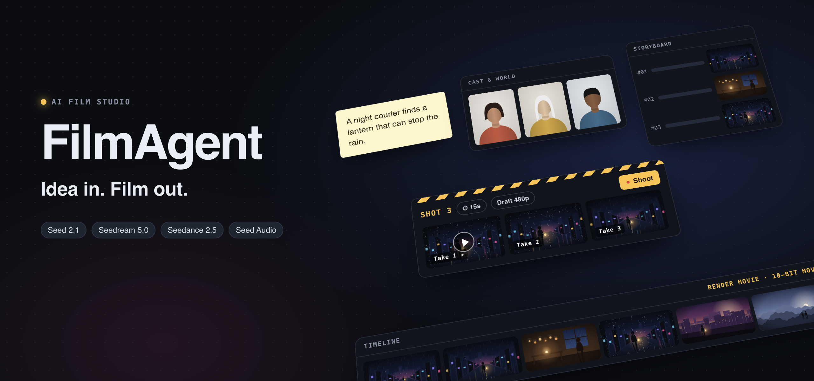</p>

<p align="center">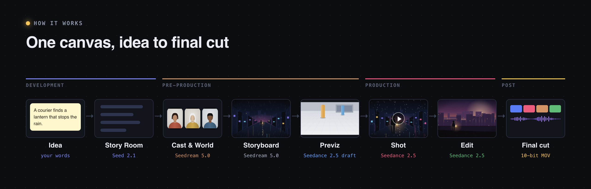</p>

## Development

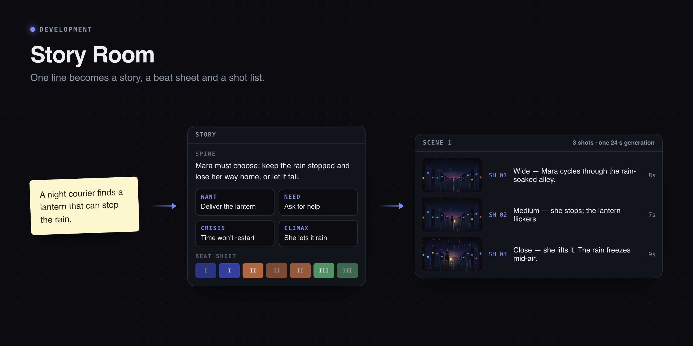
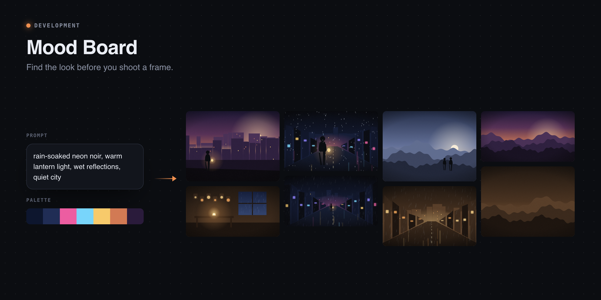

## Pre-production

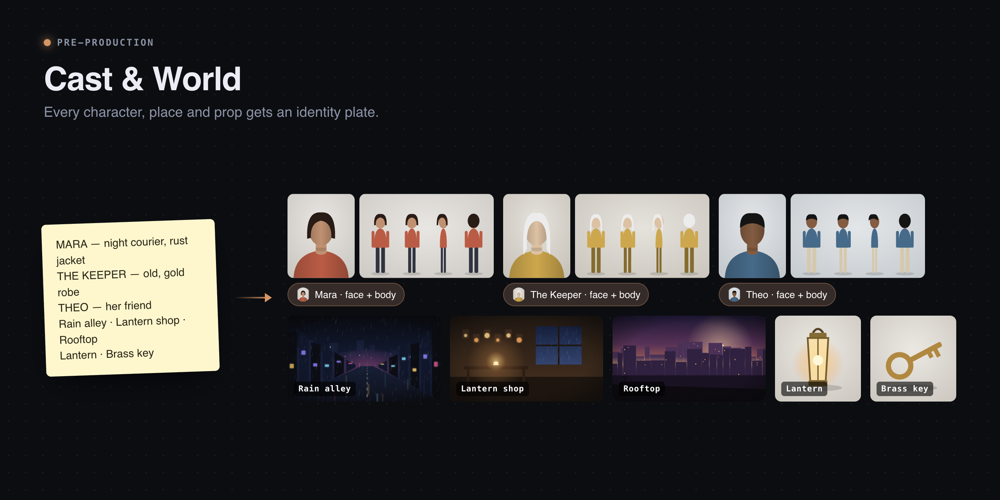
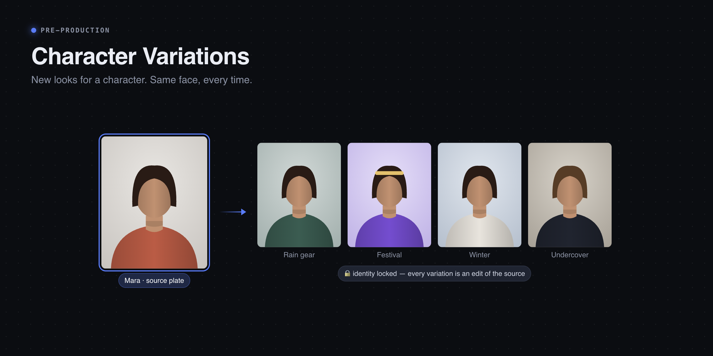
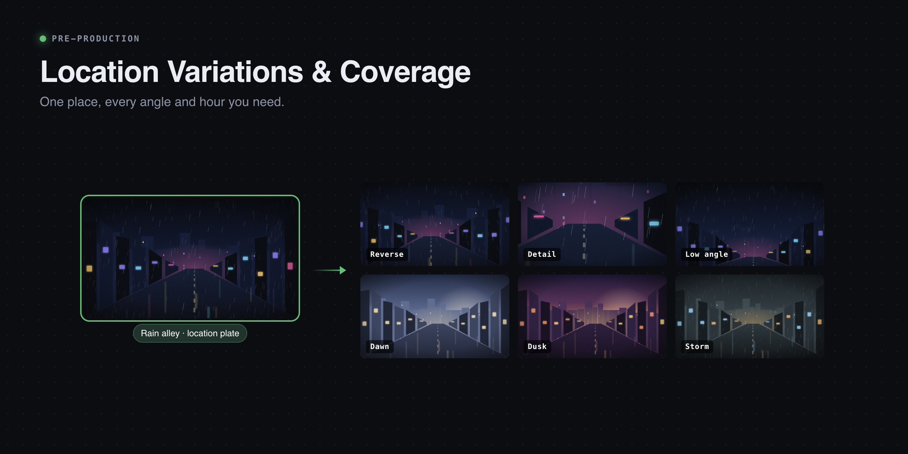
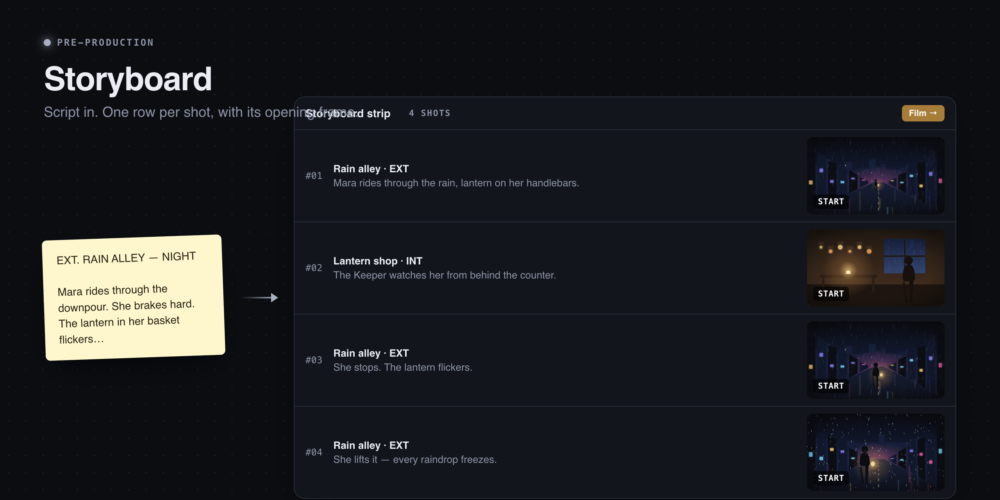
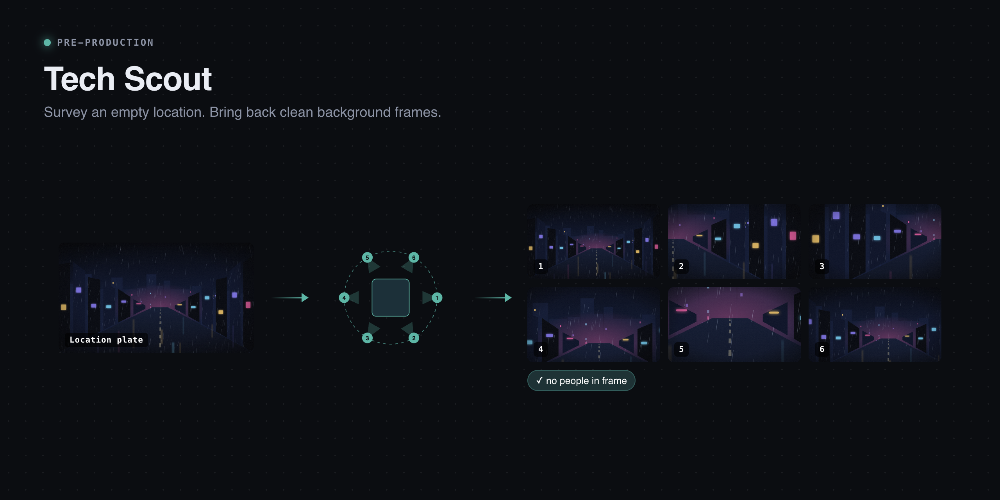
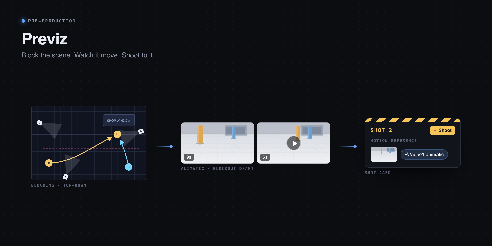

## Production

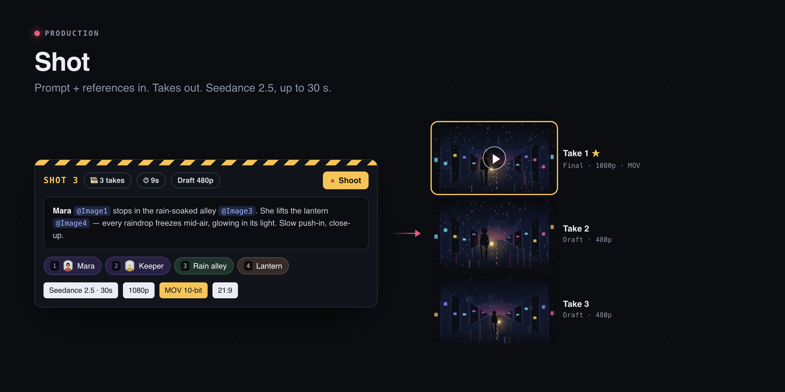
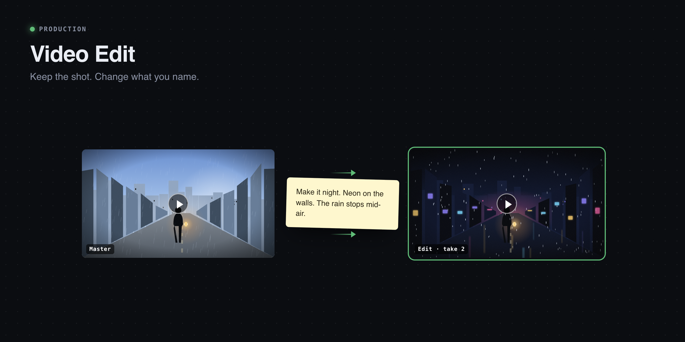

## Post-production

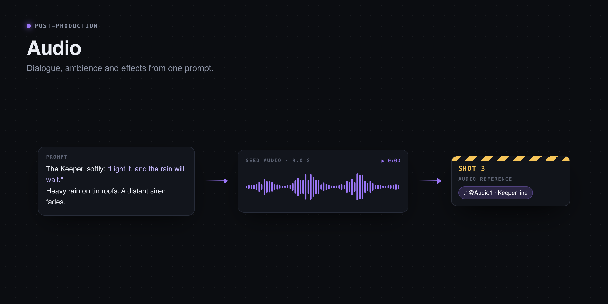
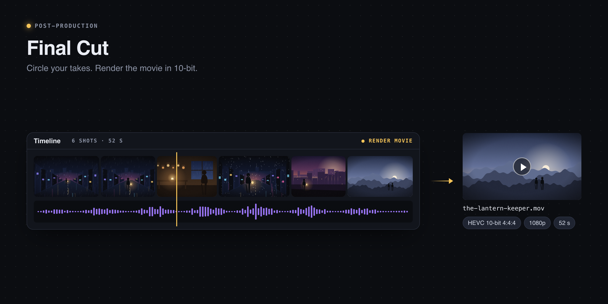

## Tools

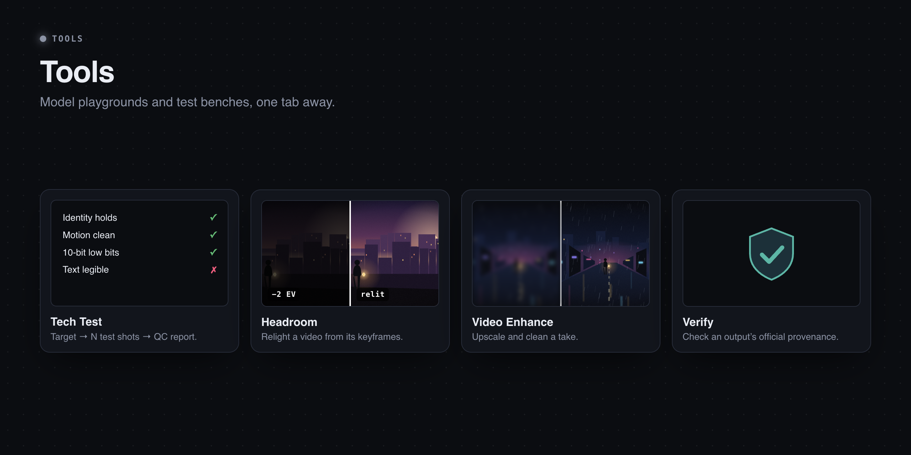

## Run it

```bash
git clone git@github.com:RaiaN/FilmAgent.git && cd FilmAgent
npm install
cp .env.example .env.local   # your ModelArk key, model endpoints, TOS bucket
NODE_USE_SYSTEM_CA=1 npm run dev
```

Open http://localhost:3000. Deploying for a team: [DEPLOYMENT.md](DEPLOYMENT.md).

<sub>Images are illustrations, drawn in code: `npx electron docs/art/render.js`</sub>
